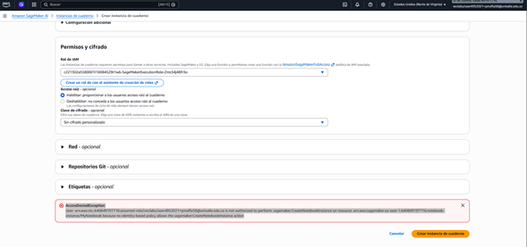
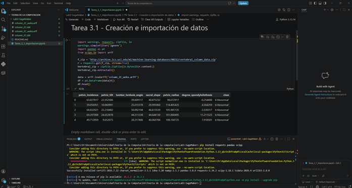
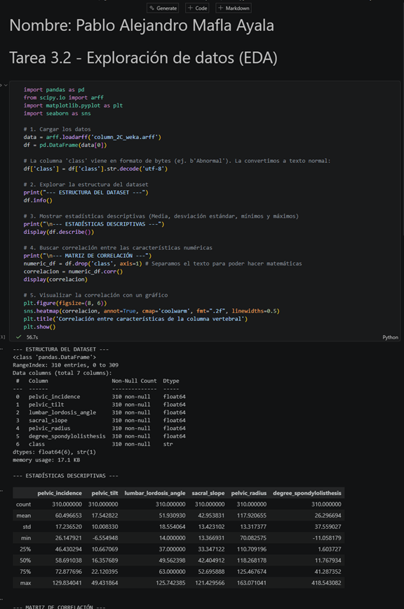
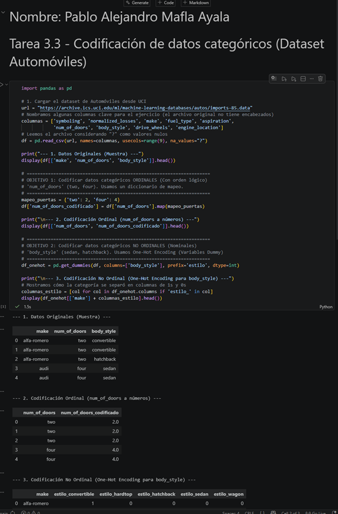
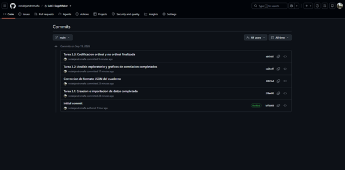

# Lab3-SageMaker# Laboratorio 3: Amazon SageMaker - Encuentro Virtual 3

**Estudiante:** Pablo Alejandro Mafla Ayala  
**Asignatura:** [Nombre de tu Asignatura]  
**Institución:** Universidad de La Salle

---

## 1. Evidencia de Acceso y Configuración

**Nota Técnica sobre el Entorno:** 
Durante la configuración de la instancia `ml.m4.xlarge` bajo la plataforma Vocareum (AWS Academy), el rol asignado (`voclabs`) arrojó un error de políticas restrictivas de IAM (`AccessDeniedException`), impidiendo la acción `sagemaker:CreateNotebookInstance`. De acuerdo con las instrucciones de la actividad, que permiten utilizar el "notebook elegido", y demostrando capacidad de resolución de incidentes técnicos, procedí a clonar el repositorio y ejecutar los laboratorios en un entorno local (Jupyter Notebook en VS Code) garantizando el cumplimiento de todos los objetivos y los commits requeridos.

---

## 2. Desarrollo de Tareas

### Tarea 3.1 - Amazon SageMaker: Creación e importación de datos
**Explicación:** Se importaron las librerías necesarias (`pandas`, `requests`, `zipfile`, `scipy`) para realizar la conexión, descarga y extracción del archivo .zip que contenía el dataset sobre la columna vertebral desde el repositorio de UC Irvine. Los datos en formato ARFF fueron convertidos y cargados exitosamente en un DataFrame.

### Tarea 3.2 - Amazon SageMaker: Exploración de datos
**Explicación:** Se procedió a realizar el análisis exploratorio (EDA). Se decodificaron las variables de clase y se generaron estadísticas descriptivas (`df.describe()`). Adicionalmente, se construyó una matriz de correlación utilizando `seaborn` y `matplotlib` para identificar visualmente la relación entre las diferentes variables biomédicas.

### Tarea 3.3 - Amazon SageMaker: Codificación de datos categóricos
**Explicación:** Utilizando el dataset de automóviles, se aplicaron dos estrategias para preparar datos para Machine Learning:
1. **Codificación Ordinal:** Se utilizó un diccionario de mapeo para variables con orden lógico (ej. número de puertas "two", "four" transformadas a valores numéricos).
2. **Codificación No Ordinal:** Se implementó *One-Hot Encoding* (`pd.get_dummies`) para variables nominales sin jerarquía (como el estilo de carrocería), creando vectores binarios.

---

## 3. Gestión del Repositorio

Se evidencia el historial de commits realizados directamente desde la terminal del entorno de desarrollo durante la ejecución de los cuadernos:

---

## 4. Reflexión Final

A través de esta serie de laboratorios comprendí la importancia del preprocesamiento estructurado en los flujos de trabajo de Machine Learning. El proceso abarcó desde la ingesta de datos en crudo, pasando por el análisis estadístico y visual para entender las variables subyacentes, hasta la codificación final (Ordinal y One-Hot Encoding) que es vital para que los modelos algorítmicos puedan interpretar datos categóricos. Adicionalmente, el enfrentarme a restricciones de IAM en la nube me permitió afianzar mis habilidades para replicar entornos de desarrollo de ML de manera local mediante Git y Jupyter, asegurando la continuidad del despliegue tecnológico.